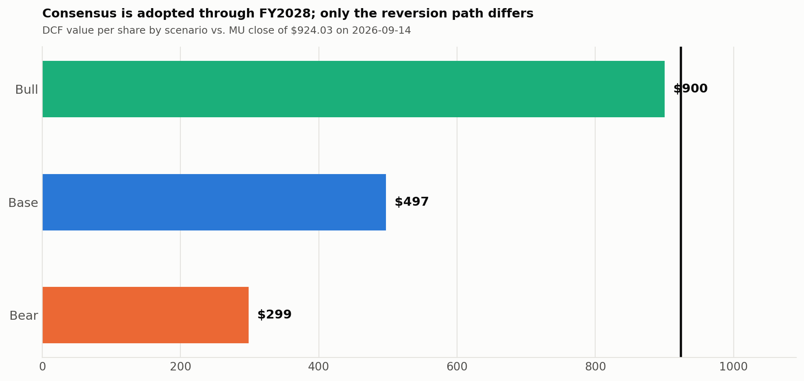
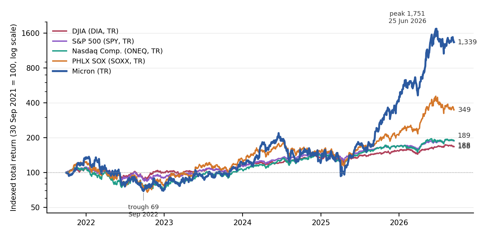

# Equity Research: Micron (MU) and Oracle (ORCL)

Two firm-analysis reports written for the **Student Managed Investment Fund Competition (SMIFC)** as part of the Lewis University Investment Club. Both follow the competition's five-section brief: business niches, diversification, stockholder performance, financial strengths and weaknesses, and valuation and recommendation.

| Report | Competition | Call | Target | Price at pricing date |
|---|---|---|---|---|
| [Micron Technology (MU)](micron/MU_SMIFC_Chicago_2026_Report.pdf) | SMIFC Chicago, Sep 2026 | **SELL / Underweight** | $548 (range $500–$570) | $924.03 (14 Sep 2026), −41% implied |
| [Oracle (ORCL)](oracle/ORCL_SMIFC_South_2026_Report.pdf) | SMIFC South, Mar 2026 | **BUY** | $166.08 (range $122–$228) | $155.52 (19 Mar 2026), +6.8% implied |

**My role:** I led the quantitative sections (§3 Stockholder Performance, §4 Financial Strengths & Weaknesses, §5 Valuation & Recommendation) and modeling on both reports, and wrote the preliminary Section 5 valuation analysis that was condensed into each final report. Sections 1–2 were written by teammates.

---

## Micron Technology (MU): SELL

**Thesis.** The report accepts LSEG I/B/E/S consensus through FY2028 and disagrees only after that. At $924, Micron trades at 6.0× FY2027 consensus EPS. That multiple isn't high, but it prices in a level of earnings that the memory industry has never sustained. Gross margins of 83–87% across business units are an industry-wide shortage rent, not a product moat. Mobile & Client, the least differentiated unit, earned the same margin as HBM-weighted Cloud Memory. A reverse DCF shows that $924 needs roughly $240B of revenue at a 77% gross margin held in perpetuity.

<p align="center"></p>

**Valuation approach**
- **Scenario DCF (70% weight):** revenue is split into a *contracted* tranche (strategic customer agreements with banded pricing) and a *spot* tranche, each with its own margin path. Bull / base / bear values are $900 / $497 / $299, with 25/50/25 weights giving $548.
- **Reverse DCF:** solves for the terminal gross margin required at each level of sustained revenue to justify the market price.
- **Cross-checks (30%):** calendarized forward comparables against SK hynix, Samsung, Kioxia, SanDisk, Nanya and Western Digital; P/B on rolled-forward book against ROE; and a replacement-cost asset floor.
- **Cost of capital:** WACC of 14.1% from a peer-beta build, with sensitivity of the target to the WACC assumption.
- **Falsification criteria:** the report states which observable data would invalidate the thesis (§5.9) and lists its own limitations (§5.10).

**Stockholder performance (§3).** Five-year TSR is +1,238.5% (+68.7% annualized) with a −57.6% maximum drawdown. It is benchmarked against the DJIA (named in the brief), the S&P 500, the Nasdaq and the PHLX Semiconductor Index. The report argues that SOX, not the DJIA, is the fair benchmark for a stock with a beta of 2.2.

<p align="center"></p>

## Oracle (ORCL): BUY

The thesis covers the database franchise as a cloud adoption funnel, the $553B RPO backlog, and operating leverage as OCI scales, set against a $50B annual capex program and $95–110B of debt. The target is a weighted blend of exit-multiple DCF (35%), perpetuity-growth DCF (15%), LTM and NTM EV/EBITDA comparables, the 52-week range and consensus.

---

## Repository contents

```
micron/
  MU_SMIFC_Chicago_2026_Report.pdf   final submitted report (12 pp.)
  models/MU_DCF_Model.xlsx           scenario DCF (switch in cell B7), scenario summary, reverse DCF
  models/MU_comps.xlsx               comps, peer benchmark, P/B vs ROE, WACC build
  codebook/MU_section_3_TSR.ipynb    total-return, volatility, Sharpe, beta and drawdown calculations
  codebook/MU_sections_4_5.ipynb     ratio analysis, scenario valuation and exhibit generation
  data/mu_provenance.csv             source log: every figure traced to its filing or database
  data/                              SEC-derived annual and TTM financials, ratios, computed return tables
  exhibits/                          charts used in the report
oracle/
  ORCL_SMIFC_South_2026_Report.pdf   final report
  models/                            DCF and trading comps workbooks
```

**Tools:** Python (pandas, NumPy, matplotlib, openpyxl), Excel, LSEG Workspace, SEC EDGAR / XBRL, FRED.

**Data note:** Raw price histories, consensus estimates and fundamentals pulled from LSEG Workspace and Interactive Brokers are licensed and are not included here. The notebooks keep their executed outputs, so every result is visible. Re-running them requires those inputs placed under `data/`. Filings-based data (SEC EDGAR, FRED) are included.

*Academic work prepared for a student competition. Not investment advice.*
